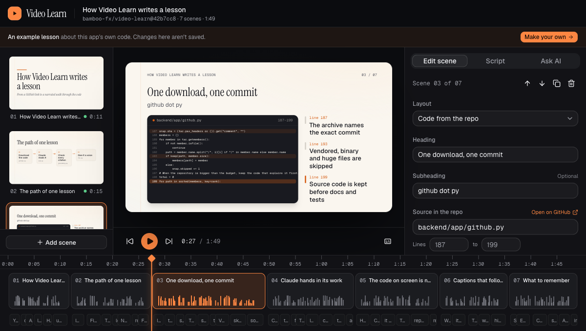
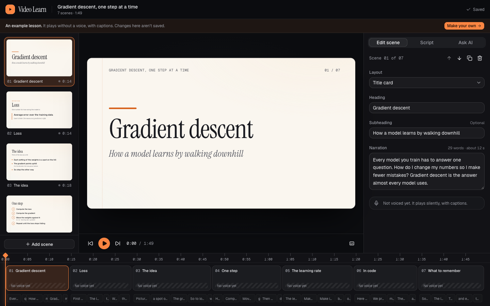

# Process log

Video Learn turns a GitHub repository into a short narrated lesson about its code that you can watch and edit like a video.

## 2026-11-16: Catching up on two ideas before this one

**Stage:** Empathize, Ideate

**What I did.** My proposal was for a reconciled website and media software platform for collegiate athletic departments. I found the communications directors for CMS athletics by email and went in person. Jeremy, the CMS communications director, showed me their current Sidearm Sports website and FanWord, the media app they use. By my prototype presentation I had switched to a mobile app for credit card maxxing, to maximize points. I did three user interviews with Jug, Leon and Taichi, whom I found in the CS lab. (Written on 11/16 about work from before the proposal, due 10/28, and the prototype presentations on 11/4 and 11/9.)

**What I learned.** Jug, Leon and Taichi had differing levels of experience with credit cards and getting points. I talked with them about their motivations for it, whether they wanted to maximize credit card points, and how to navigate doing so.

**What changed because of it.** I switched away from the athletics platform because I wanted to do something more consumer, and I wanted to credit card max. Then I switched again because I wanted to build something I would actually use every day, and that I thought was actually helpful for learning.

**Evidence.** My proposal and prototype presentation slides on Canvas (not in this repo).

**Next.** Find a learning problem I have myself, and check whether other people have it too.

## 2026-11-16: Pivot to Video Learn, and the first prototype

**Stage:** Empathize, Define, Prototype, Test

**What I did.** I talked to my friend Luke in the CS lab. He's a student who's learning agentic coding, and he said he has difficulty navigating his own codebase. My first prototype was a Claude skill I made that creates narrated explainer videos. I liked the videos it made, so I showed Luke one, and then built the app. The first build taught any topic (#12 to #17).

**What I learned.** When I showed Luke the video, he thought it was pretty good and intuitive, and he liked the AI voice. I also found myself wanting to switch the medium of exchange with my coding agent. My point of view: a student learning agentic coding needs to learn about their codebase visually, because sometimes text is hard to interpret. Teaching any topic was too broad.

**What changed because of it.** I narrowed it to code. I chose code because it's easy to plug and play: right now you paste a GitHub link into the browser, and Claude reads the repository and makes a narrated lesson that shows the real lines (#21, #22).

**Evidence.** #21, #22

**Next.** Build it as a curl command or a package, so people can run it in the terminal.

## 2026-11-16: Building it with AI coding agents

**Stage:** Prototype, building

**What I did.** The calls were mine, and AI coding agents did the implementation, one pull request per slice: the plan (#12), the storyboard schema (#13), the backend (#14), the editor and player (#15), Claude writing and ElevenLabs voicing (#16), failure states (#17), and lessons about a codebase (#21, #22). It's live on Railway.

**What I learned.** You can parallelize work in multiple worktrees or multiple chat windows; just make sure the agents don't touch each other's work. Cloud environments help with this too.

**What changed because of it.** Every pull request was reviewed by Greptile, a review bot, and merged only once it scored 5/5. The reviews caught real bugs before merging: an AI edit that could erase what I was typing, daily limits that requests running at the same time could slip past, and a failed rewrite that could point a lesson at newer code.

**Working with AI.** I read the pull requests and used Greptile as a second reviewer. CLAUDE.md grew a Lessons section from real agent mistakes, like committing a database file and dropping the title field (#17). I added a /snap skill that screenshots the app for this log (#17).

**Evidence.** #12 to #17, #21, #22 (all merged at Greptile 5/5); the screenshots in process/screens/

**Next.** The terminal version above.
